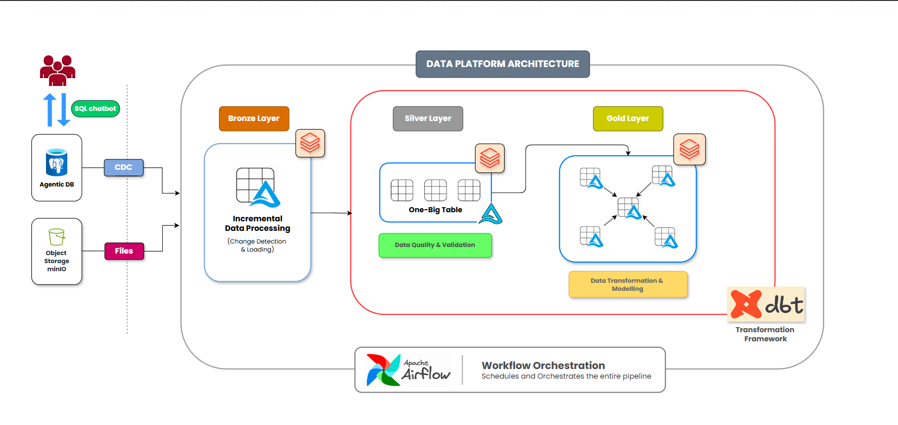

# 🗄️ Supermart Airflow, dbt & Databricks Lakehouse Pipeline

Welcome to the Supermart Airflow, dbt & Databricks Lakehouse Pipeline repository! 🚀

This project presents a comprehensive, end-to-end data lakehouse solution engineered to ingest, transform, and model high-volume retail datasets. Covering the complete data lifecycle—from raw data extraction out of PostgreSQL (utilizing Ghost DB database backends) and landing zones, through robust PySpark and modular dbt transformations, to automated orchestration via Apache Airflow—this project demonstrates modern data engineering best practices in cloud lakehouse architecture, data modeling, and workflow automation.


## 📌 Project Overview
The **Supermart Airflow, dbt & Databricks Lakehouse Pipeline** simulates a real-world enterprise data engineering workflow. Modern organizations face challenges handling siloed, raw operational data across relational databases and cloud environments. This project solves that problem by building a fully automated, end-to-end data platform that moves raw data from relational sources through robust processing tiers, ensuring high data quality, seamless orchestration, and lightning-fast analytics.

This project involves:
1. **Data Architecture:** Designing a modern cloud data lakehouse using a 3-tier Medallion Architecture (Bronze, Silver, and Gold layers).
2. **ETL Pipelines:** Extracting raw data from PostgreSQL (Ghost DB) source instances, transforming via PySpark and dbt, and loading into structured targets.
3. **Workflow Orchestration:** Automating, scheduling, and managing pipeline dependencies using Apache Airflow TaskFlow workflows.
4. **Data Modeling & Analytics:** Developing optimized star-schema dimensional models and modular data models for high-performance analytics.

🎯 This repository is an excellent resource for professionals and students looking to showcase expertise in:
- Data Engineering
- Cloud Data Lakehouse
- Apache Airflow
- Databricks & PySpark
- dbt (Data Build Tool)
- PostgreSQL / Ghost DB


## 🚀 Project Requirements

### 🛠️ Data Lakehouse Development (Data Engineering)
**Objective**
Design and implement a modern cloud data lakehouse using Apache Airflow, dbt, Databricks, and PostgreSQL (Ghost DB) to consolidate high-volume retail data and enable reliable analytical reporting and data-driven decision-making.

**Specifications**
- **Data Ingestion:** Extract and load raw operational data from PostgreSQL (Ghost DB) database instances and CSV files into cloud-simulated landing storage (Bronze Layer).
- **Data Quality & Transformation:** Perform automated data cleansing, deduplication, schema validation, and type casting using PySpark and dbt staging models (Silver Layer).
- **Data Integration & Modeling:** Integrate cleansed data streams into an optimized Star Schema dimensional model (Gold Layer) with facts and dimensions built for high-speed querying.
- **Workflow Orchestration:** Automate end-to-end task execution dependencies, scheduling, and error handling using Apache Airflow TaskFlow DAGs.
- **Documentation & Data Governance:** Compile interactive dbt documentation and catalog definitions to support technical teams and business stakeholders.


### 📊 Enterprise Data Marts & Analytics Engineering

**The Core Objective**
Develop modular dbt transformations, Spark SQL models, and curated analytical data marts in Databricks to serve high-performance business intelligence across key retail domains:

- **Customer Behavioral Analytics:** Tracking customer acquisition, purchase frequency, order value distribution, and segmentation.
- **Product & Category Performance:** Evaluating top-performing inventory SKUs, sales volume, category revenue breakdown, and stock velocity.
- **Sales & Financial Growth Metrics:** Modeling executive-level KPIs, monthly recurring revenue trends, order fulfillment rates, and sales margins.

**Technical Delivery**
- **Curated Fact & Dimension Tables:** Built star-schema dimensional models optimized for low-latency analytical queries.
- **Bi-Directional Consumption Ready:** Models are structured for seamless connection to downstream BI dashboards (e.g., Power BI, Tableau, or Databricks SQL) and executive reporting systems.

## 🏗️ Data Architecture & Pipeline Flow

The pipeline processes operational data from transactional databases and cloud file storage into a structured Delta Lake / Databricks environment, fully managed by **dbt** for transformations and **Apache Airflow** for end-to-end orchestration.



### ⚙️ Pipeline Components & Data Flow

* **Source Layer:** Stream real-time transactional data from **Agentic DB (PostgreSQL)** via CDC and ingest raw batch datasets from **MinIO**.
* **Ingestion Tier:** Process incoming stream and batch feeds incrementally using **Databricks & Delta Lake** for efficient delta loading.
* **Staging & Quality:** Consolidate data into a denormalized **One-Big-Table (OBT)** and execute automated data quality checks.
* **Transformation Tier:** Model validated data into a star-schema (Fact & Dimension tables) using **dbt**.
* **Orchestration:** Automate and monitor end-to-end task execution, dependencies, and error handling via **Apache Airflow**.

## 📂 Repository Structure

```
AIRFLOW_DBT_LAKEHOUSE_PIPELINE/
├── dags/
│   └── supermart_pipeline_dag.py     # Apache Airflow orchestration DAGs & task dependencies
├── models/
│   ├── staging/                      # dbt staging models (Silver layer OBT & cleansing)
│   └── marts/                        # dbt core models (Star-schema fact and dimension tables)
├── seeds/                            # Local reference CSV datasets and lookups
├── macros/                           # Reusable custom SQL transformation macros
├── tests/                            # Automated data quality & schema assertion tests
├── analyses/                         # Ad-hoc analytical queries and data profiling scripts
├── dbt_project.yml                   # dbt project configuration, profiles, and catalog settings
└── README.md                         # Project documentation and architecture guide
```

## 🛡️ License

This project is licensed under the [MIT License](LICENSE). You are free to use, modify, and share this project with proper attribution.


## 👤 About Me

Hi, I’m **Kshitij Gudekar** — a Data Analyst transitioning into **Data Engineering & AI Data Engineering**.

I specialize in designing scalable cloud data lakehouses, building robust ETL/ELT pipelines, and implementing modular data architectures that turn raw data into high-value analytical assets.

* 💼 **Experience:** 6+ years in data analytics, database migration, automation frameworks, and pipeline optimization.
* 🛠️ **Core Tech:** SQL, Python, PySpark, dbt, Apache Airflow, Databricks, PostgreSQL, and Cloud Storage.
* 📬 **Connect:** [GitHub Portfolio](https://github.com/Kshitij0077-G)
